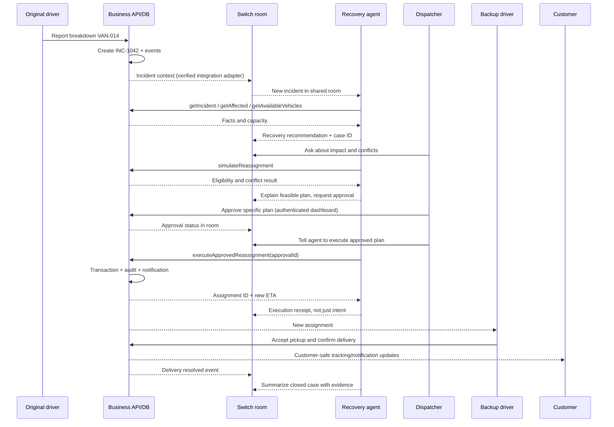

# 03 — Human, agent and system workflows

## Canonical end-to-end diagram

**Integration detail:** arrows between API and Switch represent an adapter to be implemented/verified with official APIs or a supported bridge. Never assume Switch includes outbound webhooks or magic APIs. MVP fallback: a human posts incident ID in room and the agent calls the business API. The live demo still requires real agent and real tool calls.

## State machines
Incident: `OPEN -> INVESTIGATING -> AWAITING_APPROVAL -> APPROVED -> EXECUTING -> MONITORING -> RESOLVED`. Allowed alternate branches: `AWAITING_APPROVAL -> REJECTED`, `EXECUTING -> FAILED`, `MONITORING -> ESCALATED`; failed/rejected can return to investigating with a NEW proposal version. `RESOLVED` is terminal except explicit controlled re-open. No direct OPEN→RESOLVED.

Shipment: `IN_TRANSIT -> AT_RISK -> REASSIGNMENT_PENDING -> REASSIGNED -> PICKED_UP_BY_BACKUP -> DELIVERED`. Failure paths `EXCEPTION` or `DELIVERY_FAILED`; no delivery completion before pickup/acceptance.

RecoveryPlan: `DRAFT -> PROPOSED -> APPROVED|REJECTED|EXPIRED -> EXECUTED|EXECUTION_FAILED`. Revision invalidates old approval.

Approval: explicit `PENDING -> APPROVED|REJECTED|EXPIRED|CONSUMED`, with version, actor, timestamp, scope, expiry and plan hash. **Single use**.

## Sub-flows
### A. Intake / deduplication (driver human)
1. Driver selects VAN-014 and reason BREAKDOWN; UI shows impacted assignments.
2. POST creates case with idempotency key. Repeated submit returns same case, not duplicates.
3. Server marks affected shipment AT_RISK and writes `INCIDENT_CREATED`.
4. Operator/adapter sends incident ID to Switch room; ack captured as event if verifiable.
5. If Switch unavailable: incident remains OPEN and dispatcher sees 'agent collaboration unavailable'; manual dispatch can proceed, not hidden.

### B. Agent investigation
1. Agent references exact case ID, reads facts using read-only API key/role.
2. Prioritize by promised delivery and service priority; make no unsupported claims.
3. Finds eligible spare VAN-009 and checks capacity, ETA, existing commitments.
4. Builds proposed plan with reason and structured reference; write as PROPOSED.
5. Announces the plan in the room with what can be approved and what remains uncertain.

### C. Human decision
1. Dispatcher examines evidence and challenges plan in same room.
2. Agent may re-run simulation; if new plan differs, version increments; previous approval invalid.
3. Dispatcher opens authenticated /ops/exceptions/INC-1042, approves plan-specific hash. Switch-room text `approved` alone is **not trusted** without authenticated identity mapping and documented verified bridge.
4. Dashboard shows decision source and immutable audit.
5. Agent must ask for current approval state before execution.

### D. Execution (agent action)
1. Agent invokes approved execution tool with case, plan and approval ID.
2. Server atomic transaction checks role, plan hash/version, unexpired unused approval, available capacity, shipment not delivered and target driver valid.
3. Commit shipment assignment, approval CONSUMED, plan EXECUTED and `REASSIGNMENT_EXECUTED` event atomically.
4. Update customer-safe ETA + notification record; return assignment ID and status.
5. Agent posts success or precise failure receipt in Switch room. Duplicate executions return same receipt.
6. No agent can self-approve.

### E. Field verification / customer closure
1. Backup driver sees new job, accepts, picks up.
2. Customer sees updated ETA and explanation (no internal staff deliberations).
3. Driver completes delivery with seeded proof reference.
4. Case closes only if critical shipment delivered; remaining shipments remain separately tracked and acknowledged, or case retains follow-up if affected tasks outstanding. For demo, explicitly seed all relevant outcomes or mark partial resolution accurately.
5. Room receives final closure summary and dashboard timeline shows it.

## Other useful demo sub-flows (P1)
- Customer report of wrong package → support triage → warehouse verification request → manager approval for redelivery → new assignment → customer outcome.
- Failed delivery due to recipient absent → customer picks time slot → dispatcher capacity verification → replanning → updated ETA.
Both reuse same incident/plan/approval/events core; do not implement before hero works.

## Failure and recovery table
| Failure | Expected behavior |
|---|---|
| Duplicate incident POST | Return existing case by idempotency key |
| Switch offline | UI says degraded; no fake agent success |
| Agent tool timeout | Retry safe read; write only via idempotent execution |
| No backup capacity | Agent recommends escalation/manual dispatch, never invents vehicle |
| Two dispatchers approve conflicting plans | Only latest plan revision approvable; concurrency check |
| Approval rejected/expired | Execution returns 403/409; case remains open |
| Driver declines assignment | Mark declined, reopen planning |
| Customer refresh | Sees durable state from DB |
| Agent hallucinated tool result | Server rejects nonexistent identifiers and invalid transitions |
| Delivery proof missing | Cannot mark delivered or resolve |
| Map unavailable | Plain table and case workflow remain usable |

## Invariants
Shared correlation ID in every mutation; server-computed transitions; customer-safe event projection; audit append-only; human approval scoped to exact plan; no unauthorized writes; eventual Switch room updates must never be mistaken for source of truth.
